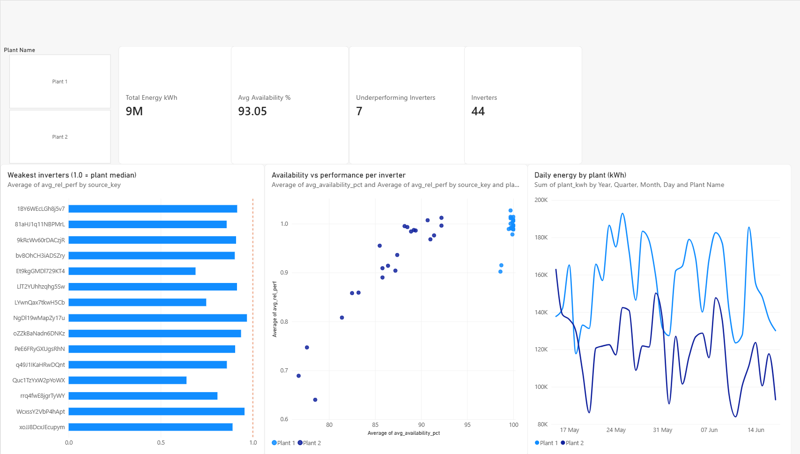
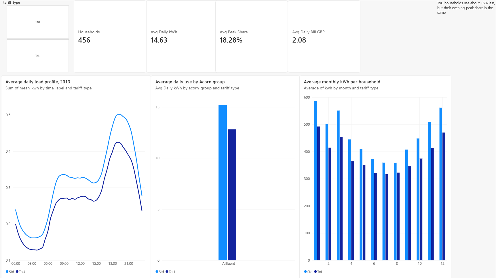

# Solar Generation & Smart-Meter Analytics

An end-to-end data analysis project on two real energy datasets: how well solar
inverters perform (supply side) and how households use electricity (demand side).
Raw CSVs go in, and a MySQL star schema, SQL KPI views and a 3-page Power BI
dashboard come out.

## Questions this project answers
1. **Solar supply:** which inverters in two Indian solar plants underperform, and is
   it because they are down or because they are weak when running?
2. **Household demand:** when do households use electricity, and do time-of-use
   (ToU) tariff customers behave differently from standard-tariff customers?

## Key findings
- **Solar:** [FILL: e.g. "N Plant 2 inverters produced zero AC power in about 17-23%
  of daylight intervals, versus about 98-99% availability at Plant 1."]
  The data does not show the cause (fault, curtailment or maintenance).
- **Household demand:** ToU households used about 16% less electricity per day than
  standard-tariff households (12.8 vs 15.2 kWh), but their share of use between 17:00
  and 20:00 was about the same (18.6% vs 18.2%). ToU was a trial group, so the
  difference cannot be credited to the tariff alone.
- **Data quality:** Plant 1's DC power column appears roughly 10x smaller than
  Plant 2's, so DC-based efficiency is not used. Details in `docs/data_findings.md`.

## Dashboard



## Data sources (all real, nothing simulated)
| Dataset | What it is | Used for | License |
|---|---|---|---|
| Solar Power Generation Data (Kaggle) | 2 plants, 22 inverters each, 15-minute AC/DC power and weather sensors, 34 days | Inverter availability and performance | [FILL: from the dataset page] |
| Smart meters in London (UK Power Networks, via Kaggle) | Half-hourly household readings, tariff type, Acorn group, weather | Demand profiles, Std vs ToU | [FILL: from the dataset page] |

The two datasets come from different places and are never joined. Raw data is not
stored in this repo (about 1.7 GB); download links are above.

## Pipeline
```
Raw CSVs (Kaggle)
   -> pandas: clean, validate, build daily summaries   (notebooks 01-04)
   -> MySQL star schema (dimension + fact tables)      (sql/schema.sql, notebook 05)
   -> SQL KPI views (window functions, CTEs)           (sql/kpis.sql)
   -> CSV exports -> Power BI dashboard                (dashboard/)
```

## Tech stack
Python (pandas, NumPy, SciPy, SQLAlchemy, PyMySQL), MySQL 8, Jupyter in VS Code,
Power BI Desktop, Git.

## KPIs
- **Solar:** inverter availability %, energy yield, yield per unit of sunlight,
  relative performance vs plant median, plant daily energy with a 7-day average.
- **Households:** daily consumption, evening-peak share (17:00-20:00), night
  baseload, load factor, billed amount (assumption below), temperature
  sensitivity, low-consumption candidates for review.

## Repo structure
```
notebooks/   01-04 explore and build tables, 05 load into MySQL
sql/         schema.sql (star schema), kpis.sql (KPI queries and views)
dashboard/   Power BI file, CSV exports, screenshots
docs/        KPI definitions, data findings and quality log
```

## How to run
1. Clone the repo, create a virtual environment and run `pip install -r requirements.txt`.
2. Download both datasets into `data/raw/solar/` and `data/raw/london/`.
3. Create a MySQL database and a `.env` file with `DB_HOST`, `DB_USER`,
   `DB_PASSWORD`, `DB_NAME`.
4. Run the notebooks in order (01 to 05), then `sql/kpis.sql` in MySQL Workbench.
5. Open `dashboard/minigrid_dashboard.pbix` (or reload the CSVs in `dashboard/exports/`).

## Assumptions and limitations
- The solar data covers only 34 days, so there is no seasonal analysis.
- The London sample uses 2013 only. It is 456 households with a full year of data
  (348 standard, 108 ToU), taken from the first 10 of 112 data blocks. [FILL: update
  this line if you resample across all blocks.]
- Billing uses a flat 14.228p/kWh for every household. This is an assumption; the
  ToU price schedule is not in the downloaded data.
- Missing generation rows are counted as unavailable.
- Low-consumption households are candidates for review, not proof of a fault.
- London households are not rural Indian ones, so the two modules are kept separate.

## Possible next steps
Add the ToU price schedule for real billing, resample households across all blocks,
add a short-term solar generation forecast, and test anomaly detection further.
